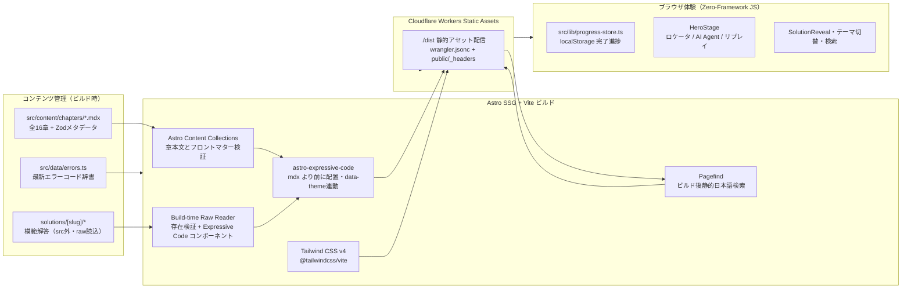
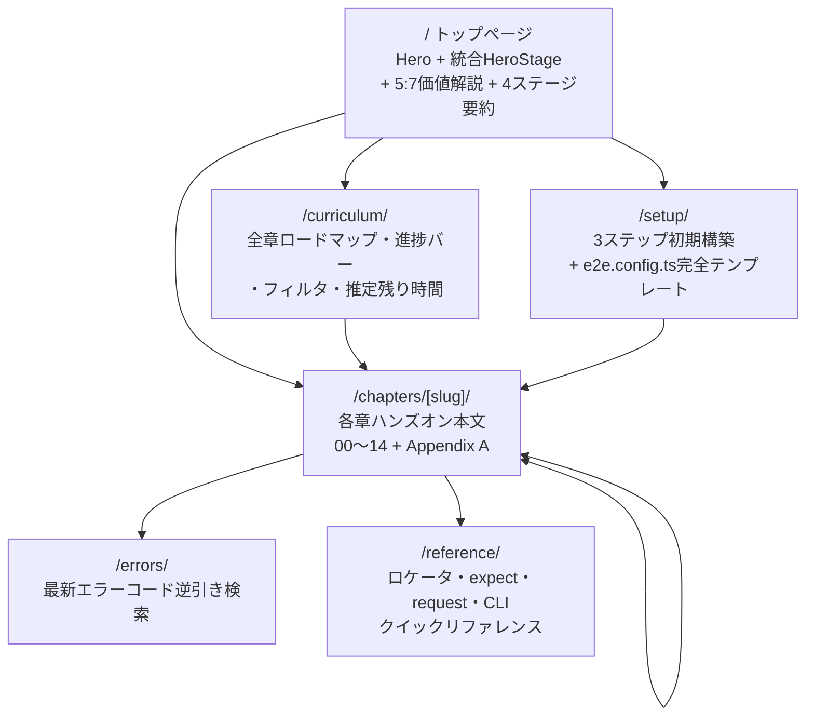

# e2e Zero to Hero ハンズオンサイト構築 実装プラン

## Goal Description

**e2e inc.**（旧 TesterArmy、公式リポジトリ `github.com/e2e-inc/e2e` / `https://e2e.com/docs`）が提供するエージェント型 E2E テストフレームワーク `e2e` をゼロから実務レベルまで学べる日本語ハンズオンサイト **`e2e Zero to Hero`**（リポジトリ: `rymetry/e2e-learn`）を新規構築する。

- **コンテンツ基準**: `rymetry/tester-army-e2e-tutorial`（全 16 章: Part 1 第 00〜14 章 + 付録 A、`e2e@0.23.1` 基準）の段階的学習構成と公開練習用アプリ（`test-automation-practice-app.rymetry.workers.dev`）の即時実行体験を土台にしつつ、最新の公式ドキュメント・API（**`e2e@0.25.0`** / **`@e2e-dev/web@0.17.0`** / **`@e2e-dev/github@0.4.7`**）へ全面刷新する。
- **リポジトリ基盤**: `rymetry/repo-template` からサイト専用リポジトリを作成し、`setup-repo.sh`・`AGENTS.md`・`docs/architecture/overview.md`・`ci.yml`（`check` ジョブ）・`@mizchi/mutator` の運用基盤を継承する。
- **技術基盤**: **Astro**（完全 SSG）+ **Tailwind CSS v4**（`@tailwindcss/vite`）+ **Cloudflare Workers Static Assets**（Cloudflare Workers Builds による自動本番デプロイ＋PR プレビュー）。
- **デザイン方針**: `gemini-frontend-design` に準拠した精密・高視認性の「Precision Lab」デザインを構築し、装飾ノイズ・過剰なクライアント JS・不要な機能を排除する。

---

## 確定した要件

| 項目 | 確定内容 |
| --- | --- |
| 教材ソースと対象版 | 最新 `e2e@0.25.0` / `@e2e-dev/web@0.17.0` / `@e2e-dev/github@0.4.7`（`https://e2e.com/docs`、`github.com/e2e-inc/e2e`）を基準に、`tester-army-e2e-tutorial` 全 16 章の破壊的変更・新機能差分をすべて反映して執筆・移行する。 |
| リポジトリ名・公開範囲 | `rymetry/e2e-learn`（`--public` リポジトリ） |
| サイトタイトル | **`e2e Zero to Hero`**（`e2e` 小文字 + 標準 Title Case、コロンなし） |
| リポジトリ構成 | 案 1: **サイト専用リポジトリ**（ルート直下が Astro プロジェクト） |
| リリース追従ツール | `tracking/`, `scripts/release-diff.mjs`, `.github/workflows/release-watch.yml` を取り込み、300 ファイル上限対策・多言語除外・新 docs 対応・SHA 固定など 4 点の改修を施して運用する。 |
| ドメイン方針 | 現時点は独自ドメインなし（`e2e-learn.rymetry.workers.dev` で公開）。将来のサブドメイン移行に備え、`SITE_URL` 環境変数と `wrangler.jsonc` のゼロペイン移行設計を初期から組み込む。 |
| デプロイ方式 | **Cloudflare Workers Builds**（GitHub 連携による `main` 自動本番デプロイ + PR プレビュー、`wrangler >= 4.135.0` の `wrangler preview` 採用）。 |
| v1 スコープ整理（`ponytail`） | ブラウザ内メモ欄・Markdown エクスポート（旧案 `ChapterNotes.astro`）は v1 から除外し、`docs/architecture/overview.md` の「後で決めること」へ記録する。v1 の `localStorage` は章完了チェック・全体進捗バー・「続きから再開」CTA・進捗リセットに絞る。 |

> [!NOTE]
> **初回デプロイ時の手動作業メモ**: リポジトリ作成と初回コード反映後、Cloudflare ダッシュボードで Workers Builds に `rymetry/e2e-learn` を接続し、ビルド変数 `SITE_URL`（本番 URL）を設定する工程のみ手動操作が必要です。なお Workers Previews のプレビュー URL は既定で公開 URL となるため、検索エンジン除外（`noindex` 3 層対策）を初期から組み込みます。

---

## 技術選定とアーキテクチャ



### 採用技術・重要設計判断

| 役割 | 採用技術 | 設計上の必須要件・注意点 |
| --- | --- | --- |
| Framework | **Astro（最新安定版 / SSG）** | 導入時に最新 Astro メジャーと `astro-expressive-code` / `@astrojs/mdx` / `@tailwindcss/vite` のピア依存整合を確認。`trailingSlash: 'always'` + `build: { format: 'directory' }` で末尾スラッシュ有り URL に統一。SSR 不要のため `@astrojs/cloudflare` は入れない。 |
| Styling | **Tailwind CSS v4 (`@tailwindcss/vite`)** | `@theme` でデザイントークンを一元管理。旧 `@astrojs/tailwind` は不使用。 |
| Code Highlight | **astro-expressive-code** | `astro.config.mjs` で **`expressiveCode()` を必ず `mdx()` より前に配置**。`useDarkModeMediaQuery: false`, `themeCssRoot: 'html'`, `themeCssSelector: (t) => \`[data-theme="${t.type}"]\`` を設定し、手動テーマ切替と完全連動させる。 |
| Solutions Storage | **`solutions/<slug>/*`（`src/` 外）** | サイト専用リポジトリに `e2e` / `@e2e-dev/web` は導入しないため、`src/content/` 内に `.ts` 解答を置くと `astro check` / `tsc` が型エラーで落ちる。ルート直下の `solutions/<slug>/` に隔離し、`tsconfig.json`・`biome.json`・`mutator.config.ts` から除外。ビルド時に raw 文字列として読み込み、`astro-expressive-code/components` の `<Code />` で描画する。 |
| Hosting / Deploy | **Cloudflare Workers Static Assets + Workers Builds** | プロジェクトローカル **`wrangler >= 4.135.0`** を導入。`workers_dev: true`, `preview_urls: true`, `previews: {}`, `assets.html_handling: "auto-trailing-slash"`, `assets.not_found_handling: "404-page"`。Workers Builds の Build: `pnpm build`、本番 Deploy: `pnpm exec wrangler deploy`、非本番 PR Preview: `pnpm exec wrangler preview`。 |
| Search | **Pagefind** | `astro build && pagefind --site dist` で生成。クライアントからは `const p = '/pagefind/pagefind.js'; await import(/* @vite-ignore */ p)` + `try/catch` で読み込み（Vite ビルド失敗および `astro dev` 404 回避）。`<main data-pagefind-body>` とし、ヘッダー・サイドバー・フッター・`SolutionReveal` に `data-pagefind-ignore` を付与してネタバレ防止。 |
| Testing / Mutation | **Vitest 5 + `@mizchi/mutator` + `astro check`** | `@mizchi/mutator@0.5.5` のリファレンスランナーに合わせて **Vitest 5** を採用。純粋ロジックを `src/lib/chapter-utils.ts`（`astro:*` 非依存）へ完全分離し、`src/lib/chapters.ts` は薄い `getCollection` アダプタに徹する。`mutator.config.ts` で `include: ['src/lib/**/*.ts']`、`exclude: ['src/lib/chapters.ts', '**/*.test.ts']` を明示。 |
| Lint / Format | **Biome + `astro check`** | `biome.json` に `"css": { "parser": { "tailwindDirectives": true } }` を設定。Biome の対象は `.ts / .js / .mjs / .json / .css` に絞り、`**/*.astro`・`**/*.mdx`・`solutions/**`・`.astro`・`.wrangler`・`dist` を除外。`.astro` は `astro check` に責務分離し、クライアント `<script>` ロジックは `src/lib/*.ts` に切り出す。 |
| Package / Runtime | **Node 24 + `pnpm@10.8.0` + ESM** | `.node-version` に `24`、`package.json` に `"type": "module"`、`pnpm.onlyBuiltDependencies`（`["esbuild", "sharp", "workerd"]` 等、導入時に実確認）を設定。スクリプト名は `pnpm deploy` 衝突回避のため **`"cf:deploy": "wrangler deploy"`** とする。 |

### Cloudflare プレビュー `noindex` 3 層対策と将来のサブドメイン移行

1. **ゼロペインのサブドメイン移行**:
   - `astro.config.mjs` の `site` は `process.env.SITE_URL ?? 'https://e2e-learn.rymetry.workers.dev'` で環境変数注入する（`SITE_URL` 未設定の CI ビルドでも `new URL(..., Astro.site)` が失敗しないよう、山括弧を含まない有効 URL をフォールバックに設定）。
   - canonical URL、`@astrojs/sitemap`、`og:url`、`og:image` はすべて `new URL(..., Astro.site)` で絶対 URL 生成する。
   - 将来サブドメインへ移行する際は、Workers Builds の `SITE_URL` 更新 + `wrangler.jsonc` へ `routes`（`custom_domain: true`）追加 + `workers_dev: false`（またはリダイレクト設定）のみで完了する。
2. **プレビュー環境のインデックス防止（3 層防御）**:
   - Workers Builds が注入する `WORKERS_CI=1` / `WORKERS_CI_BRANCH` を使って以下 3 層で保護する:
     1. `src/pages/robots.txt.ts`（静的エンドポイント）: `main` ブランチ以外は `Disallow: /`、本番は `Allow: /` + `Sitemap:`。
     2. `src/layouts/BaseLayout.astro`: プレビュービルド時に `<meta name="robots" content="noindex, nofollow" />` を出力。
     3. `public/_headers`: プレビュー用 `workers.dev` ホスト（`https://*-e2e-learn.*.workers.dev/*` および `https://:version.:subdomain.workers.dev/*`）に `X-Robots-Tag: noindex` を付与。
3. **セキュリティヘッダとキャッシュ境界（`public/_headers`）**:
   - 全ルートに `X-Content-Type-Options: nosniff`、`Referrer-Policy: strict-origin-when-cross-origin`、`X-Frame-Options: DENY`、`Permissions-Policy` を付与。
   - `Cache-Control: public, max-age=31536000, immutable` は Astro のハッシュ付き生成物 **`/_astro/*` のみ**に限定し、HTML および `/pagefind/*` には付けない。
   - CSP は Pagefind WASM（`'wasm-unsafe-eval'` / `worker-src 'self' blob:`）・インラインテーマスクリプト・Google Fonts との整合検証が必要なため v1 では見送り、`docs/architecture/overview.md` に将来方針として記載する。

---

## サイト構成とルーティング（全 URL 末尾 `/` 統一）



### 各ページの役割と UX 設計

1. **トップページ (`/`)**:
   - **Hero + 統合ワークベンチ `HeroStage`**: ファーストビュー内に収まる高さ予算で、決定論ロケータ・AI Agent・リプレイキャッシュの 3 モードを即体験できる対話ステージを配置。単一 CTA は初回訪問者が `第 00 章から始める`、進捗保存済みの再訪者は同じ単一ボタンのまま `続きから再開（第 XX 章）` へ自動差し替えする。
   - **この教材で身につくこと（5:7 非対称エディトリアル分割）**: 3 列カードは使わず、左 5 カラムに主旨を固定し、右 7 カラムに `1px` ヘアライン区切りの 3 項目（「コード未経験から実務レベルへ」「公開練習用アプリで準備ゼロ開始」「第 05 章までは AI モデル不要で無料完結」）とインライン SVG 図解を配置。
   - **4 ステージ要約（`/` と `/curriculum/` の重複解消）**: `/` には全 16 章を並べず、**4 ステージ要約（00–05 基礎 / 06–08 AI Agent / 09–11 設計・運用 / 12–14+A 応用）**と代表章・`/curriculum/` への導線のみを簡潔に提示。
   - **練習用アプリ接続ガイド要約**: `test-automation-practice-app.rymetry.workers.dev` の訪問者別セッション分離と 3 接続モード（公開 URL / `APP_URL` / `APP_DIR`）を案内し、`/setup/` へ接続。

2. **カリキュラム一覧 (`/curriculum/`)**:
   - 全 16 章（Part 1 第 00〜14 章 + 付録 A）のフィルタ付き一覧、全体完了率バー（`tabular-nums`）、推定残り時間、「前回の続きから再開」導線、進捗リセット機能を集約。
   - 絞り込みセグメントはモバイル 1 行収容のため短縮ラベル: **`すべて` / `モデル不要` / `AI モデル使用` / `未完了`**。
   - Part 2（モバイル Expo 第 15〜17 章）は末尾にリンクなしのプレーン行＋ミュート文字「準備中」で静かに予告（バッジ・無効ボタンなし）。

3. **セットアップガイド (`/setup/`)**:
   - サイト専用リポジトリのため、学習者が既存教材を clone せず手元で完結できる **コピペ完結の 3 ステップ初期構築** を提供:
     1. 動作要件確認（Node.js `24.8+` または `22.22.3+`、Web テストは Bun `1.4.3+` も可）と作業ディレクトリ `my-e2e-hands-on/` 作成・`npx e2e@latest init`（無モデル選択は **Skip for now**）。
     2. 公開練習用アプリの 3 接続モード（既定公開 URL / `APP_URL` / `APP_DIR`）組込み済みの **`e2e.config.ts` 完全テンプレート**（`defineConfig` 使用）。
     3. 最初のスモークテスト実行と期待される緑パス出力の確認（第 06 章以降のモデル認証 `npx e2e login openai` / `AI_GATEWAY_API_KEY` も後半に集約）。
   - 全 16 章を通じて作業ディレクトリパスを **`my-e2e-hands-on/`** に正規化し、元リポジトリ固有の `chapters/03-.../` パスを残さない。

4. **章ページ (`/chapters/[slug]/`)**:
   - **2 トラック学習導線**: TypeScript 初学者は `第 00 章 → /setup/ → 第 01 章`、経験者は `/setup/ → 第 01 章` へ迷わず進めるよう、第 00 章冒頭にスキップ案内・末尾に `/setup/` 導線を置き、**`ChapterLayout` 左サイドバーにも `/setup/` を第 00 章と第 01 章の間に配置**する。
   - **レスポンシブ 3 カラム読書ワークスペース**:
     - **`xl (>= 1280px)`**: 3 カラム（左: 章ナビ＋完了状態、中央: `max-width: 65ch` 本文、右: On this page 目次＋クイックリンク）。
     - **`lg (1024–1279px)`**: 2 カラム（左: 章ナビ、右: 本文＋記事上部の折りたたみ `<details>` 目次）。
     - **`< 1024px`**: 1 カラム＋ドロワーナビ＋記事上部折りたたみ目次。
   - **右サイドバーのクイックリンク**: 「エラー逆引き (`/errors/`)」「練習用アプリ URL コピー」に加え、**「練習用アプリを新しいタブで開く」** リンクを配置。
   - **模範解答ビューア (`SolutionReveal.astro`)**: フロントマターの `solutionFiles` を単一ソースとして `ChapterLayout.astro` 章末（または章末解答エリア）に自動レンダリング（MDX 本文側との二重定義を防止）。複数ファイル解答は展開内タブで切替可能にし、`data-pagefind-ignore` で検索ネタバレを防止。
   - **章完了コントロール & 前後章ナビ**: 章末の「この章を完了にする」はボタン乱立を避けスイッチ／チェックボックス型コントロールにする。第 14 章の「次の章」からは付録 A へ自然に遷移する。

5. **エラーコード逆引き (`/errors/`)**:
   - 全 16 章の「よくある失敗」と最新 `docs/reference/errors.mdx` の全エラーコードを統合したクライアント側検索・カテゴリ絞り込みページ。該当章へのディープリンク付き。

6. **クイックリファレンス (`/reference/`)**:
   - ロケータ優先順、主要 `expect` マッチャー、`request` フィクスチャ、`agent.act / assert / waitFor / extract`、`e2e` CLI フラグ・レポーター・`platforms` 指定の一覧。

---

## デザイン仕様（`gemini-frontend-design` 準拠）

### 1. ブランド表記・タイポグラフィ・メタデータ

- **採用表記**: **`e2e Zero to Hero`**（全小文字やコロン `e2e:` は不採用）。
- **ヘッダーワードマーク**: 装飾ボックス・ピルなし。`e2e` を `IBM Plex Mono`（700・`--accent`・`letter-spacing: -0.03em`）、`Zero to Hero` を `IBM Plex Sans JP`（600・`--text-primary`・`letter-spacing: -0.02em`）で同一ベースラインに並べ、ナビリンクより明確に大きく太く表示（`390px` でも 1 行維持）。
- **`<title>` タグ（`|` 区切り、em ダッシュ禁止）**:
  - トップ: `e2e Zero to Hero | e2e inc. 実践ハンズオン`
  - 下層: `第 06 章 AI Agent ステップ | e2e Zero to Hero`
- **OGP 画像 (`1200x630`)**: `e2e`（Mono 700・`--accent`）+ `Zero to Hero`（Sans 700）を主役、副題 `e2e inc. 実践ハンズオン・全 16 章` と Precision Lab のヘアライン図形のみで構成（バッジ・ピルなし）。
- **厳密 2 フォント上限**:
  1. **Sans**: `IBM Plex Sans JP`（ウェイト `400 / 500 / 600 / 700`、欧文内包のため `IBM Plex Sans` は重複読み込みしない）
  2. **Mono**: `IBM Plex Mono`（ウェイト `400 / 600 / 700`、進捗・時間には `font-variant-numeric: tabular-nums`）
- **本文 3 サイズ体系（`13px` 未満ゼロ厳守）**:
  - `--text-heading`: `1.5rem`（24px / `line-height: 1.3` / `letter-spacing: -0.02em`）セクション `<h2>`
  - `--text-body`: `1rem`（16px / `line-height: 1.75`）本文・リスト・`<h3>`（太字と余白・色で差別化）・ボタン・表本文
  - `--text-sm`: `0.875rem`（14px / `line-height: 1.5`）メタ情報・サイドバー・表ヘッダ・コード内テキスト。**`astro-expressive-code` のファイルタブ・コピー枠や Pagefind UI 既定 CSS も `>= 0.875rem` (`14px`) で上書き**し、Expressive Code の背景・枠色も Precision Lab トークンへ統一する。

### 2. カラーパレット: 「Precision Lab」

| トークン | Light モード（既定: Daylight Lab） | Dark モード（Ink Observatory） | 用途 |
| --- | --- | --- | --- |
| `--bg-page` | `#F6F7F5` | `#0B100E` | ページ背景 |
| `--bg-surface` | `#ECEFEA` | `#131B18` | サイドバー・テーブルヘッダ・コード外周 |
| `--bg-elevated` | `#FFFFFF` | `#19231F` | 統合ワークベンチ・コード背景 |
| `--border-hairline` | `#D6DCD6` | `#26332E` | `1px` 区切り線 |
| `--text-primary` | `#101714`（> 15:1） | `#ECF2EE` | 本文・見出し |
| `--text-muted` | `#4A5651`（> 7:1） | `#98A8A1` | 補足・メタ情報 |
| `--accent` | `#0A6B4E` | `#34D399` | 主要 CTA・アクティブ状態・パス指標 |
| `--accent-ink` | `#FFFFFF` | `#06281E` | アクセント上の文字 |
| `--semantic-agent` | `#1D4ED8` | `#60A5FA` | AI Agent 実行状態（ステージ／表内のみ） |
| `--semantic-fail` | `#C53028` | `#F87171` | 失敗ログ・エラーコード表 |

### 3. レイアウト・UI・コピー衛生ルール

- **ヘッダー境界**: トップページ (`/`) は `y = 0` ボーダーレス＋スクロール時に `1px` 下線＋半透明サーフェス分離。下層ワークスペース画面（`/chapters/*`, `/curriculum/`, `/setup/`, `/errors/`, `/reference/`）は初期状態から `1px` 下線で境界を明確化。
- **Hero (`/`) の高さ予算と日本語折り返し**:
  - `<h1>` 上にサイト名や eyebrow を一切置かない。見出しは 14〜18 文字へ圧縮（例: `コードと AI で、壊れにくい E2E を書く。`）、`clamp(2rem, 5.2vw, 4.25rem)`、`line-height: 1.15–1.2`、`text-wrap: balance`（改行斜体スプリットなし）。
  - 補足コピーは 1〜2 行・50 文字以内（本文に `e2e` を自然に含める）+ 単一 CTA。
  - `1440x900` で `HeroStage` をファーストビューへ収めるため、**Header + `<h1>` + 補足 + CTA の合計高さを `<= 360px`** に収める。
- **統合ワークベンチ `HeroStage`**:
  - 外枠 1 枚（`--bg-elevated` + `1px` 外周）の内部を **`1px` ヘアライン分割のみ**で仕切り、入れ子カードを一切作らない。
  - タブ文言は短縮（`ロケータ` / `AI Agent` / `リプレイ`）して `390px` でも 1 行維持。モバイル時は縦積みまたは `コード` / `実行ログ` 切替 + `<pre>` 内限定横スクロール + 切替時 CLS ゼロ（最小高さ固定）。
- **章ページ `<h1>` 上の eyebrow 禁止**:
  - `/chapters/[slug]/` 本文カラムは `<h1>`（例: `第 06 章　AI Agent ステップ`）で直接開始し、所要時間・モデル要否・対象バージョンは `<h1>` **直下**のヘアライン区切りメタ行（プレーン文字、ピル・タグ枠なし）に置く。
- **禁止表現・アクセシビリティ**:
  - 装飾バッジ・ピル・入れ子カード・マーケティング見出しの `01`/`02` 接頭辞・`"LIVE"` ドット・`"SCROLL"` 誘導・`ALL CAPS`（英語ラベルは `Part 1`, `On this page` 等の sentence case 厳守）を禁止。
  - 生成される HTML / JS / `<title>` / UI コピーに **em ダッシュ (`—`) およびスペース付き en ダッシュ (` – `) を一切含めない**。
  - 検索モーダルは `Cmd/Ctrl + K` とフォーカストラップに対応。トランジションは `160ms–220ms cubic-bezier(0.22, 1, 0.36, 1)` の明示プロパティのみ（`transition-all` 禁止）、`prefers-reduced-motion: reduce` を尊重。

---

## コンテンツ刷新・移行計画（`e2e@0.25.0` / `@e2e-dev/web@0.17.0` 準拠）

### 共通移行ルール

1. **ブランド・URL・バージョン統一**: `TesterArmy` 表記を `e2e inc.` に統一（必要箇所に 1 回のみ「旧 TesterArmy」を補足）。各章「読む」節の参照は **`https://e2e.com/docs/...` への直接リンク主軸**へ刷新し、`node_modules/e2e/docs/...` はオフライン補足扱いとする。対象版は **`e2e@0.25.0` / `@e2e-dev/web@0.17.0` / `@e2e-dev/github@0.4.7`**。
2. **作業パス正規化 & MDX 記法統一**: 全章のコマンド・ファイルパスを `my-e2e-hands-on/` に統一。`stop-verify.sh` のコンフリクトマーカー誤検知を避けるため、MDX 見出しは Setext 形式（`=======`）を禁止し **ATX 見出し（`##`, `###`）のみ**で記述する。
3. **フロントマターと模範解答の単一ソース化**:
   ```ts
   // src/content.config.ts
   import { defineCollection, z } from 'astro:content';
   import { glob } from 'astro/loaders';

   const chapters = defineCollection({
     loader: glob({ pattern: '**/*.mdx', base: './src/content/chapters' }),
     schema: z.object({
       chapterNumber: z.string(),        // "00".."14", "A"
       order: z.number().int(),          // 0..15
       part: z.enum(['part-1', 'appendix']),
       title: z.string(),
       summary: z.string(),
       modelRequirement: z.enum(['none', 'partial', 'optional', 'required']),
       estimatedMinutes: z.number().int(),
       e2eVersion: z.string().default('0.25.0'),
       webVersion: z.string().default('0.17.0'),
       prerequisites: z.array(z.string()).default([]),
       solutionFiles: z.array(z.object({
         filename: z.string(),
         lang: z.string(),
         sourcePath: z.string(),        // "solutions/<slug>/<file>"
       })).default([]),
     }),
   });

   export const collections = { chapters };
   ```
   - `solutionFiles` はフロントマターを単一ソースとし、`ChapterLayout.astro` が章末に `<SolutionReveal files={entry.data.solutionFiles} />` を自動レンダリングする（`sourcePath` の実在はビルド時およびテストで検証）。

### 章・ページ別アップデートマトリクス

| 対象 | 更新度 | 最新 `e2e@0.25.0` / `@e2e-dev/web@0.17.0` 反映内容 |
| --- | --- | --- |
| **`/setup/`** | 新規・最新化 | 3 ステップ初期構築、`my-e2e-hands-on/`、`defineConfig` 済み `e2e.config.ts` 完全テンプレート、Node.js `24.8+`（または `22.22.3+`）/ Bun `1.4.3+`、`e2e init` の無モデル選択肢 **Skip for now**（旧 `None`）、Next.js 自動検出。 |
| **第 00 章** (`00-typescript-basics`) | 構成調整 | 冒頭に TypeScript 経験者向けスキップ案内、末尾に `/setup/` 導線、パス統一。 |
| **第 01 章** (`01-setup-and-first-run`) | 中規模 | 対象版を `0.25.0` / `0.17.0` へ更新、`e2e init` の **Skip for now**・Node/Bun 要件・`https://e2e.com/docs/` リンクへ刷新。 |
| **第 02 章** (`02-locators`) | 中規模 | 新ロケータ API 追記: `locator.blur()`, `locator.tap({ count })`, インメモリ `locator.setInputFiles({ name, mimeType, buffer })`。 |
| **第 03 章** (`03-expect`) | 中規模 | 新マッチャー追記: `toBeEmpty()`, `toBeInViewport({ ratio })`, `expect(fn).toPass()`, `expect(response).toBeOK()`, `expect.poll` の `intervals` 指定、ARIA ウィジェットでの `toHaveValue`。 |
| **第 04 章** (`04-test-structure`) | **破壊的刷新** | ① フィクスチャ遅延評価化（明示引数のみ実行・副作用は `[fn, { auto: true }]` 必須） ② 厳格分割代入（`async ({}, use)`・rest/単一引数で `COLLECTION_ERROR`、同一 `test.extend()` 内相互参照解禁） ③ Worker フィクスチャ `[fn, { scope: 'worker' }]` と `beforeAll`/`afterAll` での受取り（拡張時 `scope`/`auto` 非継承） ④ **`requires` 削除 → `{ platforms: ['web'] }`** 移行 ⑤ `test.fixme`, `test.todo`, `test.setTimeout`, `test.slow`, `describe(..., { parallel: true })`, `fullyParallel: true`。 |
| **第 05 章** (`05-app-and-browser`) | **破壊的刷新** | ① `browser.route` / `unroute` / `waitForResponse` / `waitForURL` の Playwright URL glob 解釈変更（`?` リテラル化、`{a,b}` 展開、相対パス `'/api/...'` の `app.url` 解決、`''` 全一致） ② 新 API: `browser.setNetwork('offline' \| 'online')`, `browser.cookies(urls)`, `web({ chromiumSandbox, deviceScaleFactor })`, `app.url` の `file:` 対応、`defineConfig` 復活。 |
| **第 06 章・第 07 章** (`06-agent-steps`, `07-replay-cache`) | 中規模 | サブスクリプション一覧へ `spacexsi`（SuperGrok 改称）を反映、`--strict-cache` の未実行ステップ挙動修正を追記。 |
| **第 08 章** (`08-debugging`) | 中規模 | ステップ実行・一時停止を新設追記: **`e2e run --step`**（TTY キー `Enter/s/l/n/a/q`、非 TTY `--step next\|rest\|stop`）、**`screen.pause()`**、停止中テストへの MCP `open_session { attach }`。 |
| **第 09 章** (`09-authentication`) | 整合更新 | `e2e inc.` 表記・`my-e2e-hands-on/` パス・公式 docs 直リンクへ統一。 |
| **第 10 章** (`10-api-testing`) | **破壊的刷新** | 生 `fetch` から組み込み **`request` フィクスチャ**（`request.get/post/put/patch/delete/head/fetch`, `{ json }`, `app.url` 相対解決, `actionTimeout`, レポート記録）＋ **`expect(response).toBeOK()`** ＋ **`browser.cookies('/api/...')`** へ全面刷新（`request` 名の自作フィクスチャ衝突注意を明記）。 |
| **第 11 章** (`11-page-objects-and-visual`) | 中規模 | `seedTodos` フィクスチャを `request` + `browser.cookies('/api/todos')` へ刷新。スナップショット画像（`home-web-darwin.png`, `navigation-web-darwin.png`）を `src/assets/chapters/11/` へ移行し Astro `<Image />` で最適化。 |
| **第 12 章** (`12-ci-and-reporters`) | **破壊的刷新** | ① stdout/stderr 分離と `--reporter list,json` 併用可能化（旧「併用不可」記述を削除） ② 新レポーター: `dot`, `line`, `ctrf` (0.3.0), **`@e2e-dev/html-reporter` (`htmlReporter()`)** + **`e2e report`** ③ `e2e/reporters` のオプション指定（`junit({ outputFile })` 等） ④ `e2e init` の CI 生成と `docs/ci/vercel-previews.mdx` 紹介。 |
| **第 13 章** (`13-explore`) | 中規模 | **`e2e explore --changed-since origin/main`**（PR タイトル・本文・diff 探索＋GitHub Actions 連携）を追記。 |
| **第 14 章** (`14-coding-agents-mcp-bug-bash`) | **破壊的刷新** | ① `e2e mcp` から **`run_tests` 削除**（テスト実行は `npx e2e run`） ② **`run_code` 全面刷新**（任意 JS・変数・ループ・`try/catch`・`return`・`console.log`・`await` 必須・テストファイル同等権限） ③ `open_session` の `path` / `attach: "<id>"` 対応 ④ `e2e init` の `AGENTS.md` / `CLAUDE.md` への skill 参照自動追記。 |
| **付録 A** (`a1-appendix-tools-and-settings`) | 中規模 | 読むだけ案内表へ `@e2e-dev/core` (`docs/core.mdx`), `@e2e-dev/desktop` (`docs/desktop.mdx`), `docs/frameworks/nextjs.mdx`, `docs/services.mdx`, `docs/self-healing.mdx`, 新ホステッド環境（`moli`, `notte`, `revyl`）を追記。 |
| **`/errors/`** | 新規・最新化 | 最新 `docs/reference/errors.mdx` と完全同期（`NODE_UNSUPPORTED`, `INVALID_LOCATOR`, `STEP_NOT_AWAITED`, `MODEL_REFUSED`, `CANCELLED`, `TYPESCRIPT_COMPILER_UNAVAILABLE`, `IMAGE_CODEC_UNAVAILABLE` 等を網羅）。 |
| **`/reference/`** | 新規・最新化 | `request`、新マッチャー（`toBeOK`, `toPass`, `toBeEmpty`, `toBeInViewport`）、新 CLI（`e2e report`, `e2e run --step`, `e2e explore --changed-since`, `e2e merge-reports`）、新レポーター（`dot`, `line`, `ctrf`, `htmlReporter()`）、`platforms` を網羅。 |

---

## リリース追従スクリプト（`release-diff`）の移植と 4 点改修

`scripts/release-diff.mjs` は `gh api` のみで動作し `e2e` npm 依存が不要なため、サイト専用リポジトリ `rymetry/e2e-learn` へそのまま組み込み、以下 4 点の必須改修を行う。

1. **GitHub Compare API 300 ファイル上限 & 多言語翻訳ディレクトリ除外**:
   - 上流 `docs/{cs,es,fr,hi,ja,pl,pt,zh}/` と `docs/images/` をフィルタで除外する。
   - `compare.files.length >= 300` に達した場合は連続タグ間（`prevTag...release.tag_name`）で段階比較するか「300 ファイル上限到達のため手動確認要」の明示警告を出力し、`docs/reference/*.mdx` 等の取りこぼしを防ぐ。
2. **`tracking/release.lock.json` 初期値と npm スクリプト整備**:
   - 初期ロックを `"e2e": "e2e@0.25.0"`, `"@e2e-dev/web": "@e2e-dev/web@0.17.0"`, `"@e2e-dev/mobile": null` に設定。
   - `package.json` に `"release:diff": "node scripts/release-diff.mjs"` を追加し、ロックファイルの案内コメントを `pnpm release:diff -- --update <tag>` へ更新。
3. **`tracking/docs-map.json` の拡張**:
   - 新設ドキュメントを追加（`10-api-testing` に `docs/reference/request.mdx`、`12-ci-and-reporters` に `docs/ci/vercel-previews.mdx`、`a1-appendix-tools-and-settings` に `docs/core.mdx`, `docs/reference/core.mdx`, `docs/desktop.mdx`, `docs/services.mdx`, `docs/self-healing.mdx`）。
   - サイト専用ページ（`setup`, `errors`, `reference`）を影響対象として検知する `pages` セクションを追加し、章パスコメントを `src/content/chapters/` 基準へ修正。併せて `scripts/release-diff.mjs` も `chapters` だけでなく `pages` を読み込んで影響表へ合算出力するよう拡張する。
4. **`.github/workflows/release-watch.yml` のセキュリティ・標準整合**:
   - 先頭コメントを `e2e-inc/e2e` へ修正。
   - `setup-repo.sh` により Actions 既定権限が `read` のみとなるため、`permissions: { contents: read, issues: write }` を明示し、全 `uses:` を `repo-template` 標準のコミット SHA 固定にする。

---

## Proposed Changes

承認後に以下の順序で構築を進めます（`setup-repo.sh` による初回初期化 push 以降は `AGENTS.md` に従い PR ベースで進行）。

### 1. リポジトリ作成と `repo-template` 初期設定

1. `gh repo create rymetry/e2e-learn --template rymetry/repo-template --public --clone`。
2. `bash .github/scripts/setup-repo.sh` を実行し、LICENSE / SECURITY.md / Branch protection / Dependabot / Secret scanning を設定。
3. 初期ドキュメント整備（公開リポジトリのため、ローカル環境固有パス等の内部情報を必ず除去して保存）:
   - #### [NEW] `docs/plans/2026-11-27-e2e-learn-site.md`（サニタイズ済みの承認プラン）
   - #### [MODIFY] `docs/architecture/overview.md`（原則・採用技術・I/O 境界・CSP 方針・「後で決めること: ブラウザ内メモ欄と Markdown エクスポート」を記載）
   - #### [MODIFY] `AGENTS.md` / `README.md` / `.gitignore`（`.astro/` と `.wrangler/` を追加）
   - #### [NEW] `.node-version`（`24`）

### 2. Astro + Tailwind CSS v4 + Cloudflare Workers 基盤構築

#### [MODIFY] `package.json`
- `"type": "module"`、`pnpm@10.8.0`、`pnpm.onlyBuiltDependencies`（`["esbuild", "sharp", "workerd"]` 等、導入時実確認）。
- 依存: `astro`, `@tailwindcss/vite`, `tailwindcss`, `@astrojs/mdx`, `@astrojs/sitemap`, `astro-expressive-code`, `pagefind`, `wrangler` (`>= 4.135.0`), `@astrojs/check`, `typescript`, `vitest` (`^5`), `@biomejs/biome`（`@mizchi/mutator` 維持）。
- スクリプト:
  - `dev`: `astro dev`
  - `build`: `astro build && pagefind --site dist`
  - `preview`: `wrangler dev`
  - `cf:deploy`: `wrangler deploy`
  - `check`: `astro check && biome check .`
  - `test`: `vitest run`
  - `mutate`: `mutator --since origin/main`
  - `release:diff`: `node scripts/release-diff.mjs`

#### [NEW] `astro.config.mjs`
- `site: process.env.SITE_URL ?? 'https://e2e-learn.rymetry.workers.dev'`、`trailingSlash: 'always'`、`build: { format: 'directory' }`。
- `integrations: [expressiveCode({ themes: [...], useDarkModeMediaQuery: false, themeCssRoot: 'html', themeCssSelector: (t) => \`[data-theme="${t.type}"]\` }), mdx(), sitemap()]`。
- `vite: { plugins: [tailwindcss()] }`。

#### [NEW] `wrangler.jsonc`
```jsonc
{
  "$schema": "node_modules/wrangler/config-schema.json",
  "name": "e2e-learn",
  "compatibility_date": "2026-11-27",
  "workers_dev": true,
  "preview_urls": true,
  "previews": {},
  "assets": {
    "directory": "./dist",
    "html_handling": "auto-trailing-slash",
    "not_found_handling": "404-page"
  },
  "observability": {
    "enabled": true
  }
}
```

#### [NEW] `public/_headers` / `src/pages/robots.txt.ts`
- 全ルート向けセキュリティヘッダ、`/_astro/*` 限定の `immutable` キャッシュ、プレビュー用 `workers.dev` ホストへの `X-Robots-Tag: noindex`。
- `robots.txt.ts` は `WORKERS_CI_BRANCH` 判定で本番 `Allow: /` + `Sitemap:`、プレビュー `Disallow: /` を生成。

#### [NEW] `biome.json` / `tsconfig.json` / `vitest.config.ts` / `mutator.config.ts`
- `biome.json`: `css.parser.tailwindDirectives: true`、`**/*.astro`・`**/*.mdx`・`solutions/**`・`.astro`・`.wrangler`・`dist` を除外。
- `tsconfig.json`: `strict`、`solutions/**` を `exclude`。
- `mutator.config.ts`: `include: ['src/lib/**/*.ts']`, `exclude: ['src/lib/chapters.ts', '**/*.test.ts']`。

#### [MODIFY] `.github/workflows/ci.yml`
- ブランチ保護の必須チェック名 `check` を維持し、`pnpm check` / `pnpm test` / `pnpm build` を実行。

### 3. デザインシステム＆コアレイアウト

#### [NEW] `src/styles/global.css`
- Tailwind v4 `@import "tailwindcss";`、`@theme`、Light/Dark パレット、2 フォント（`IBM Plex Sans JP` + `IBM Plex Mono`）、3 サイズ本文トークン、Expressive Code / Pagefind の `>= 14px` およびカラー上書き、`prefers-reduced-motion`。

#### [NEW] `src/layouts/BaseLayout.astro`
- `|` 区切り `<title>`、`new URL(..., Astro.site)` による canonical / OGP、プレビュー時 `noindex` メタタグ、Google Fonts プリコネクト（2 フォントのみ）、`data-theme` FOUC 防止インラインスクリプト、`Header`、`SearchModal`、`Footer`。

#### [NEW] `src/layouts/ChapterLayout.astro`
- `xl` 3 カラム / `lg` 2 カラム / `<1024px` 1 カラム＋ドロワー。左サイドバーは第 00 章と第 01 章の間に `/setup/` を配置。`<h1>` 直接開始＋直下ヘアラインメタ行、章末にフロントマター単一ソースの `<SolutionReveal>`・完了スイッチ・前後章ナビを配置。

### 4. 純粋ロジック層（Vitest 5 & `mutator` 対象）

#### [NEW] `src/lib/chapter-utils.ts`（純粋ロジック、`astro:*` 非依存）
- 章ソート、Part / 4 ステージグルーピング、前後章 (`prev` / `next`) 解決、モデル要否フィルタ、推定残り時間計算、模範解答パス整合バリデーション。

#### [NEW] `src/lib/chapters.ts`（薄い Astro Content Collection アダプタ）
- `getCollection('chapters')` 呼び出しのみを担当し、計算は `chapter-utils.ts` へ委譲。

#### [NEW] `src/lib/progress-store.ts`
- `localStorage` の唯一の入口。章完了フラグ配列のシリアライズ／バリデーション／次回再開章解決／リセットを純粋関数とストレージアダプタに分離。

#### [NEW] `src/lib/errors.ts` / `src/data/errors.ts`
- 最新 `docs/reference/errors.mdx` 準拠のエラーコード辞書と検索・カテゴリ絞り込み純粋ロジック。

#### [NEW] `src/lib/*.test.ts`
- 境界値・条件反転・欠損データ・解答ファイル存在確認を網羅する単体テスト（`@mizchi/mutator` 通過基準）。

### 5. UI コンポーネント＆ページ実装

#### [NEW] `src/components/Header.astro` / `Footer.astro` / `SearchModal.astro` / `ThemeToggle.astro`
- `Header.astro`: `e2e Zero to Hero` ワードマーク（Mono + Sans）、トップと下層のヘッダー境界切替、`Cmd/Ctrl + K` 検索トリガー。
- `SearchModal.astro`: `/* @vite-ignore */` 動的 Pagefind ロード、`astro dev` フォールバック、フォーカストラップ。

#### [NEW] `src/components/HeroStage.astro`
- 単一外枠＋`1px` ヘアライン分割ワークベンチ（`ロケータ` / `AI Agent` / `リプレイ`、モバイル 1 行タブ・CLS ゼロ）。

#### [NEW] `src/components/SolutionReveal.astro` / `src/components/ChapterProgressBar.astro`
- `SolutionReveal.astro`: `solutions/<slug>/` の raw 読み込み + Expressive Code `<Code />` + 複数ファイルタブ + `data-pagefind-ignore`。
- `ChapterProgressBar.astro`: 完了スイッチ、全体進捗バー、`localStorage` 連動の「続きから再開」CTA 更新。

#### [NEW] `src/pages/index.astro` / `curriculum.astro` / `setup.astro` / `chapters/[slug].astro` / `errors.astro` / `reference.astro` / `404.astro`

### 6. コンテンツ移行・ビジュアル・リリース追従

#### [NEW] `src/content.config.ts`
#### [NEW] `src/content/chapters/00-typescript-basics.mdx` 〜 `14-coding-agents-mcp-bug-bash.mdx`, `a1-appendix-tools-and-settings.mdx`
#### [NEW] `solutions/<chapter-slug>/*`（`src/` 外、最新 `e2e@0.25.0` / `@e2e-dev/web@0.17.0` 準拠コード）
#### [NEW] `src/assets/ogp.png` & `src/assets/chapters/11/*.png`
#### [NEW] `tracking/docs-map.json`, `tracking/release.lock.json`, `scripts/release-diff.mjs`, `.github/workflows/release-watch.yml`

---

## Verification Plan

### Automated Checks

```bash
# 1. repo-template 継承の hook 自己検査とスキル同期検査
bash .agents/hooks/self-test.sh
bash .github/scripts/sync-skills.sh --check

# 2. 型チェック・Astro 検証・Biome リント
pnpm check

# 3. 単体テスト（Vitest 5）および変異テスト（mutator）
pnpm test
pnpm exec mutator --since origin/main

# 4. プロダクションビルド + Pagefind 検索インデックス生成 + Wrangler 設定・アセットドライラン検証
pnpm build
pnpm exec wrangler deploy --dry-run

# 5. 生成 HTML 内の禁止ダッシュ（em ダッシュ / スペース付き en ダッシュ）ゼロ確認
# （build 成果物の UI 領域・<title> を対象に検査）
```

### Local Cloudflare Runtime & Visual Verification

1. **Cloudflare Workers ローカル検証**:
   - `pnpm preview`（`wrangler dev`）で `./dist` を `workerd` 上で起動し、全ルート（`/`, `/curriculum/`, `/setup/`, `/chapters/00-typescript-basics/`, `/chapters/06-agent-steps/`, `/chapters/10-api-testing/`, `/errors/`, `/reference/`, `/robots.txt`, `/404`）の HTTP ステータス、末尾スラッシュ挙動、`_headers`（セキュリティヘッダ・`/_astro/*` 限定キャッシュ）を確認。
   - プレビュー環境変数（`WORKERS_CI=1 WORKERS_CI_BRANCH=feat/test`）でのビルド時に `robots.txt` が `Disallow: /` かつ `<meta name="robots" content="noindex, nofollow">` が出力されることも検証。
2. **ブラウザ実描画チェック（`gemini-frontend-design` 全項目検証）**:
   - `Desktop (1440x900)`・`Laptop (1024x768)`・`Mobile (390x844)` でスクリーンショット確認:
     - `/` ファーストビュー: Header + H1 + 補足 + 単一 CTA が `<= 360px` に収まり、`HeroStage` が視界内に表示されること
     - `ChapterLayout` の 3 カラム (`>= 1280px`) / 2 カラム (`1024–1279px`) / 1 カラム＋ドロワー (`< 1024px`) 切替と横溢れゼロ
     - 厳密 2 フォント・`14px` 未満文字ゼロ（Expressive Code / Pagefind 含む）・装飾バッジ／ピル／eyebrow／入れ子カードゼロ・em ダッシュゼロ
     - `HeroStage` 切替（CLS ゼロ）・ThemeToggle とコード枠の同時切替・`SolutionReveal` 展開・Pagefind 検索（`Cmd/Ctrl + K` とネタバレ除外）・`localStorage` 進捗保存と単一 CTA 差し替え
3. **リリース追従スクリプト検証**:
   - `pnpm release:diff` を実行し、`e2e@0.25.0` / `@e2e-dev/web@0.17.0` 初期ロックで差分なし・エラー終了しないこと、および翻訳ディレクトリ除外と 300 ファイル上限処理が機能することを確認。
4. **セルフレビュー**:
   - PR 作成前に `ponytail-review` 観点で過剰抽象化・不要コード・アクセシビリティ漏れを点検。
