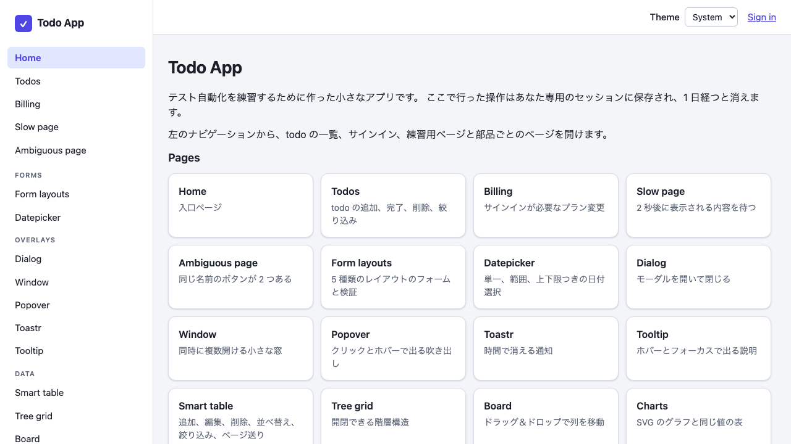
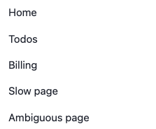

## この章で分かること

- 1 つの画面のロケータと操作を**ページオブジェクト**（クラス）にまとめ、フィクスチャで配る。
- テストデータは画面からではなく **`request` フィクスチャと `browser.cookies('/api/todos')` を使った API ヘルパーで用意**し、画面は確認に使う。
- `toHaveScreenshot` で画面の見た目を基準画像と比べる。初回は必ず失敗する流れ、許容差、マスク。

## 前提

- 第 10 章までを終えていること。
- モデルは不要。

## 一緒に書く

### 1. ページオブジェクトを書く

第 02〜04 章のテストでは、`screen.getByLabel('New todo')` や `getByRole('list', 'Todos').getByRole('listitem')` を何度も書きました。1 つの画面のロケータと操作を 1 か所に集めます。`tests/11-page-objects-and-visual/pages/todos-page.ts` を作ります（`.e2e.ts` ではないのでテストとしては拾われません）。

```ts
// tests/11-page-objects-and-visual/pages/todos-page.ts
import type { Locator, Screen } from 'e2e';

/** /todos 画面のロケータと操作を 1 か所に集めたページオブジェクト。 */
export class TodosPage {
  readonly input: Locator;
  readonly addButton: Locator;
  readonly list: Locator;
  readonly items: Locator;
  readonly remaining: Locator;

  constructor(readonly screen: Screen) {
    this.input = screen.getByLabel('New todo');
    this.addButton = screen.getByRole('button', 'Add');
    this.list = screen.getByRole('list', 'Todos');
    this.items = this.list.getByRole('listitem');
    this.remaining = screen.getByRole('status');
  }

  item(title: string): Locator {
    return this.items.filter({ hasText: title });
  }

  async add(title: string): Promise<void> {
    await this.input.fill(title);
    await this.addButton.tap();
  }

  async complete(title: string): Promise<void> {
    await this.item(title).getByRole('checkbox').check();
  }

  async remove(title: string): Promise<void> {
    await this.item(title).getByRole('button', 'Delete').tap();
  }

  async filter(name: 'All' | 'Active' | 'Completed'): Promise<void> {
    await this.screen.getByRole('group', 'Filter').getByRole('radio', name).check();
  }
}
```

**観察ポイント**

- `class` は「関連する変数と関数をひとまとめにしたもの」と読めば十分です。`constructor` が `new TodosPage(screen)` のときに動き、`this.input` のようにロケータを持ちます。
- ロケータは遅延評価（第 02 章）なので、`constructor` で全部作っておいても画面を探しに行きません。使われたときに探します。
- メソッドは「この画面でよくやる操作」だけにします。`add` / `complete` / `remove` / `filter`。全部の操作をメソッドにする必要はありません。

### 2. フィクスチャで配る（`request` + `browser.cookies('/api/todos')`）

`tests/11-page-objects-and-visual/fixtures.ts` を作ります。第 10 章で学んだ組み込みの `request` フィクスチャと、`browser.cookies('/api/todos')` を組み合わせて `seedTodos` フィクスチャを定義します。

```ts
// tests/11-page-objects-and-visual/fixtures.ts
import { test as base } from '@e2e-dev/web';
import { expect } from 'e2e';
import { TodosPage } from './pages/todos-page';

export const test = base.extend<{
  todosPage: TodosPage;
  /** API で todo を用意する。画面を通すより速く、UI の変更にも影響されない。 */
  seedTodos: (titles: string[]) => Promise<void>;
}>({
  todosPage: async ({ screen }, use) => {
    await use(new TodosPage(screen));
  },
  seedTodos: async ({ browser, request }, use) => {
    await use(async (titles) => {
      const cookies = await browser.cookies('/api/todos');
      const cookie = cookies.map((c) => `${c.name}=${c.value}`).join('; ');
      for (const title of titles) {
        const response = await request.post('/api/todos', {
          headers: cookie ? { cookie } : {},
          json: { title },
        });
        expect(response).toBeOK();
      }
    });
  },
});
```

`todosPage` はページオブジェクトを、`seedTodos` は「組み込みの `request` で todo を作る関数」を渡します。`request.post` を使っているので、データ投入の呼び出しも `trace.md` にステップとして残り、`actionTimeout` が適用されます。また、フィクスチャはオンデマンド実行（第 04 章）なので、`seedTodos` を使わないテストでは初期化すら走りません。

### 3. 使う

`tests/11-page-objects-and-visual/todos-page.e2e.ts` を作ります。

```ts
// tests/11-page-objects-and-visual/todos-page.e2e.ts
import { expect } from 'e2e';
import { test } from './fixtures';

test('adds and completes through the page object', async ({ app, todosPage }) => {
  await app.open('/todos');
  await todosPage.add('Buy milk');
  await todosPage.add('Walk the dog');
  await expect(todosPage.items).toHaveCount(2);
  await todosPage.complete('Buy milk');
  await expect(todosPage.remaining).toHaveText('1 remaining');
  await todosPage.filter('Completed');
  await expect(todosPage.items).toHaveCount(1);
  await expect(todosPage.item('Buy milk').getByRole('checkbox')).toBeChecked();
});

test('seeds data through the API, checks through the UI', async ({ app, seedTodos, todosPage }) => {
  await app.open('/todos');
  await expect(todosPage.remaining).toBeVisible(); // 画面が描画される = セッション cookie が発行済み
  await seedTodos(['one', 'two', 'three']);        // 画面を触らずに 3 件作る
  await app.open('/todos');                        // 開き直して表示を確かめる
  await expect(todosPage.items).toHaveCount(3);
  await expect(todosPage.remaining).toHaveText('3 remaining');
  await todosPage.remove('two');
  await expect(todosPage.items).toHaveCount(2);
  await expect(todosPage.item('two')).toHaveCount(0);
});
```

```bash
npx e2e run tests/11-page-objects-and-visual/todos-page.e2e.ts
```

**観察ポイント**

- テスト本体が「何をしたいか」だけになりました。ロケータの詳細はページオブジェクトの中にあり、画面が変わったらそこだけ直せば済みます。
- 2 つ目のテストで `app.open` の直後に `expect(todosPage.remaining).toBeVisible()` を挟んでいるのは、`app.open` 完了直後はまだ `browser.cookies('/api/todos')` が空のことがあるためです。練習用アプリがセッション cookie を受け取るのは、ページが `/api/me` を呼んだタイミングです。「開いた直後に裏の状態を読むときは、画面が整うのを先に待つ」と覚えてください。
- `seedTodos` のように**データの準備は API**、**確認は画面**、が実務の基本形です。画面から 3 件追加するより速く、追加フォームの UI が変わっても壊れません。

ページオブジェクトと第 06 章の `agent.act` の関係も触れておきます。「クリックして回るだけ」のメソッドの多くは、`agent.act` のゴール 1 つで置き換えられます。ページオブジェクトに残すのは、**毎回正確に同じ操作**が要るところ（フォームの入力、特定の行の操作）です。モデル不要のページオブジェクトフィクスチャの中で `agent` を引数に取らないでください。そのフィクスチャを使うテストがモデルを必要とするようになります。

### 4. 見た目を比べる: `toHaveScreenshot`

`tests/11-page-objects-and-visual/visual.e2e.ts` を作ります。

```ts
// tests/11-page-objects-and-visual/visual.e2e.ts
import { describe, test } from '@e2e-dev/web';
import { expect } from 'e2e';

// 基準画像は OS とターゲットごとに別ファイル。CI（Linux）では除外するので visual タグを付ける。
describe('visual comparison', { tags: ['visual'] }, () => {
  test('the home page looks the same as last time', async ({ app, screen }) => {
    await app.open('/');
    await expect(screen.getByRole('heading', 'Todo App')).toBeVisible();
    await expect(screen).toHaveScreenshot('home.png');
  });

  test('the navigation looks the same as last time', async ({ app, screen }) => {
    await app.open('/');
    await expect(screen.getByRole('navigation', 'Main')).toHaveScreenshot('navigation.png');
  });
});
```

1 回目は**必ず失敗します**。比べる相手がまだ無いからです。

```bash
npx e2e run tests/11-page-objects-and-visual/visual.e2e.ts
```

```text
ASSERTION_FAILED: expect.toHaveScreenshot failed
no stored screenshot at tests/11-page-objects-and-visual/visual.e2e.ts-snapshots/home-web-darwin.png; wrote this run's there. Look at it, commit it, and run again
```

**観察ポイント**: 基準画像が `tests/11-page-objects-and-visual/visual.e2e.ts-snapshots/home-web-darwin.png` と `navigation-web-darwin.png` に書き出されます。ファイル名の `web` はターゲット、`darwin` は OS です。フォントや描画が OS で変わるので、OS ごとに別の基準を持ちます。**画像を開いて、それが正しい見た目か目で確かめてから**コミットします。

実際に保存される基準画像の例です（画面全体と、ナビゲーション部品だけの比較）。





2 回目は通ります。

```text
 ✓ |web| tests/11-page-objects-and-visual/visual.e2e.ts (2 tests)
```

違う画面を同じ基準と比べると、こう失敗します（`/ambiguous` を `home.png` と比べた例）。

```text
ASSERTION_FAILED: expect.toHaveScreenshot failed
8990 pixels (0.98% of the image) differ from …/home-web-darwin.png; run with --update-snapshots to keep this run's
diff: .e2e/results/…/attempt-1/screenshots/home-diff.png
actual: .e2e/results/…/attempt-1/screenshots/home-actual.png
expected: .e2e/results/…/attempt-1/screenshots/home-expected.png
```

`-diff` は違うピクセルが赤く塗られた画像、`-actual` が今回、`-expected` が基準です。3 枚を見比べて、**意図した変更**なら基準を更新し、**崩れ**なら直します。

```bash
npx e2e run tests/11-page-objects-and-visual/visual.e2e.ts --update-snapshots
```

### 5. 許容差とマスク

時刻や広告のように毎回変わる部分があると、常に失敗します。その部分を塗りつぶすか、許容差を設けます。

```ts
await expect(screen).toHaveScreenshot('dashboard.png', {
  maxDiffPixelRatio: 0.01,                       // 1% までの違いは許す
  mask: [screen.getByTestId('last-updated')],    // この部品は塗りつぶして比べる
});
```

| オプション | 既定 | 意味 |
| --- | --- | --- |
| `threshold` | `0.2` | 1 ピクセルの色がどれだけずれても同じとみなすか（0〜1） |
| `maxDiffPixels` | `0` | 違ってよいピクセル数 |
| `maxDiffPixelRatio` | `0` | 違ってよい割合（0〜1） |
| `mask` | なし | 比較前に塗りつぶすロケータ |

Web ではアニメーションを止め、文字カーソルを隠してから撮るので、それらは気にしなくて済みます。

### 6. CI では

基準画像は OS ごとなので、Mac で作った `-darwin.png` は Linux の CI では使えません。選択肢は 2 つです。

- CI では `--exclude-tag visual` で除外する（第 12 章はこちら）。
- CI 上で `--update-snapshots` を走らせて `-linux.png` を作り、成果物としてダウンロードしてコミットする。

## 読む

- [Page object model](https://e2e.com/docs/page-object-model)（公式ドキュメント）: 全部。「Where agent goals fit」が重要。
- [Visual testing](https://e2e.com/docs/visual-testing)（公式ドキュメント）: 全部。
- [expect リファレンス](https://e2e.com/docs/reference/expect): 「Screenshot matchers」。

## 自分の言葉で書き直す

`tests/11-page-objects-and-visual/login-page.ts` に `/login` 画面のページオブジェクト `LoginPage` を書き、`tests/11-page-objects-and-visual/login-page.e2e.ts` で使ってください。

1. `username`、`password`、`submit`、`error` の 4 つのロケータと、`signIn(username, password)` メソッド。`password` の型は `string | Secret`（第 09 章の `credentials.user('alice').password` を渡せるように）。
2. テスト 1: 間違ったパスワードで `error` に "Invalid username or password"。
3. テスト 2: `credentials.user('alice')` でサインインし、URL が `/todos` になる。

詰まったらページ下部の『模範解答を見る』（`login-page.ts` と `login-page.e2e.ts`）を確認してください。

## よくある失敗

| 症状 | 原因 | 直し方 |
| --- | --- | --- |
| ページオブジェクトのファイルがテストとして拾われる | ファイル名が `.e2e.ts` で終わっている | `.ts` にする |
| `browser.cookies('/api/todos')` が空 | `app.open` 直後で、アプリがまだ cookie を発行していない | 画面の描画を `expect` で待ってから読む |
| `toHaveScreenshot` が 1 回目に失敗 | 仕様。基準画像が無い | 画像を確認してコミットし、もう一度実行 |
| 同じ実行の中で 2 回目の比較も失敗 | 同じ実行で書いた基準とは比べない | 次の実行で比べる |
| 毎回わずかに違う | 動く部分がある | `mask` か `maxDiffPixelRatio` を使う |
| CI で基準画像が無い | OS が違う | `--exclude-tag visual` か CI 上で `--update-snapshots` |

## まとめ

- ページオブジェクトは「1 画面のロケータと、毎回正確に要る操作」。フィクスチャで配る。
- データは組み込みの `request` と `browser.cookies(url)` を使った API ヘルパーで用意し、画面は確認に使う。開いた直後に裏の状態を読むなら、描画を待つ。
- `toHaveScreenshot` は初回失敗 → 画像確認 → コミット → 以降は比較。`-diff` / `-actual` / `-expected` で判断し、意図した変更なら `--update-snapshots`。
- 基準は OS ごと。CI では除外するか CI 上で作る。

次の第 12 章では、これまでのテストを GitHub Actions などの CI で動かし、タグやシャードでの絞り込みと最新レポーター群を扱います。
